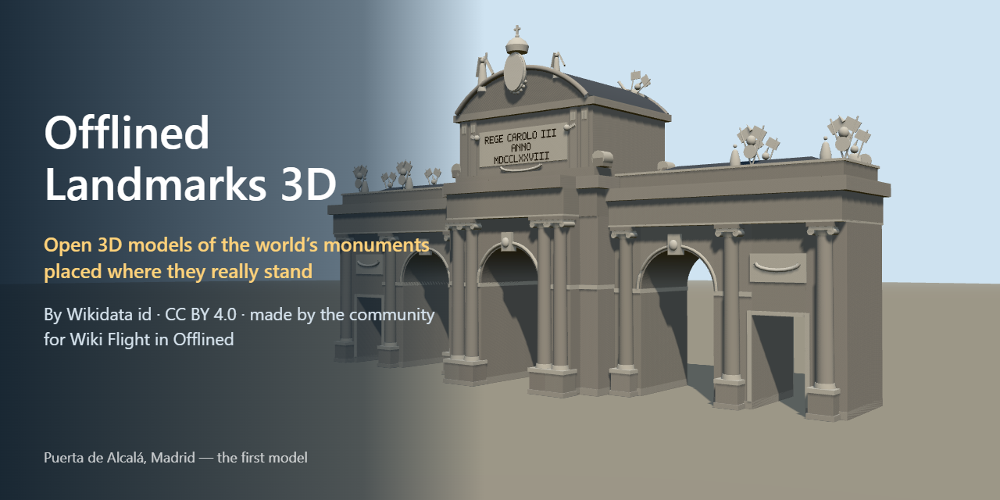

# Offlined Landmarks 3D

*[Read in English](README.md)*

**Modelos 3D abiertos de monumentos y edificios emblemáticos — cada uno unido a su artículo de Wikipedia por
su id de Wikidata, a tamaño real, colocado y orientado justo donde está.**

Un proyecto de [Offlined](https://www.offlined.org), la biblioteca sin conexión con Wikipedia, mapas y el
relieve de todo el planeta. En *Wiki Flight*, dentro de Offlined, vuelas sobre tus propios mapas descargados,
donde cada edificio se dibuja por código a partir de OpenStreetMap: una buena ciudad, pero una ciudad de cajas.
Con estos modelos, **los monumentos se parecen a sí mismos**: se quita el edificio genérico y en su lugar
aparece el de verdad. Cruza el anillo de un monumento que tenga modelo y, junto a su artículo de Wikipedia,
verás el modelo en un visor, **con el nombre de quien lo hizo y el número de modelos que ha aportado**.

**[▶ Ver los modelos en 3D](https://aruvaro-chulvi.github.io/OfflinedLandmarks3D/)** — gíralos, compara su
tamaño real con una persona, abre su artículo de Wikipedia, descarga el `.glb`.

## Qué hay aquí

| | |
|---|---|
| [`models/`](models/) | Los modelos 3D, una carpeta por id de Wikidata: `model.glb`, `meta.json` (autoría, licencia, fuentes, posición, orientación, derechos) y `preview.jpg`. Ya hay 20 monumentos de **Madrid**, de la [Puerta de Alcalá](models/Q1140634/) y el [Palacio Real](models/Q171517/) a las [Cuatro Torres](models/Q519568/). |
| [`model_sources/`](model_sources/) | Modelos hechos por código (Python + [`tools/meshkit.py`](tools/meshkit.py)): ejecutas el programa y sale el `.glb`. |
| [`docs/MODEL_SPEC.es.md`](docs/MODEL_SPEC.es.md) | Las reglas que siguen todos los modelos: glTF `.glb`, metros, ejes, origen, límites, `meta.json`. |
| [`site/`](site/) | La página web publicada en GitHub Pages. |
| [`tools/`](tools/) | El comprobador que se ejecuta en cada pull request, el que prepara las releases, un renderizador para ver un modelo sin navegador y ayudantes de Wikidata y OpenStreetMap (contorno, alturas, centro, orientación). |

## Cómo funciona en Offlined

1. Offlined descarga la última [release](https://github.com/Aruvaro-Chulvi/OfflinedLandmarks3D/releases/latest):
   su `manifest.json` y los modelos, cada uno comprobado por tamaño y SHA-256.
2. En Wiki Flight, donde hay un modelo, no se dibujan los edificios, árboles ni farolas que el mapa habría
   puesto dentro de su **planta**, y el modelo se apoya en el suelo, girado hacia su orientación real.
3. **Funciona en ordenadores modestos.** Cada release lleva una versión de lejos de cada modelo (más o menos
   1/8 de sus triángulos, hecha automáticamente). El modelo completo solo se dibuja de cerca, y solo unos pocos
   a la vez (2, 4 u 8 según la calidad); a más de 7 km, nada. Un modelo puede tener como mucho 150.000
   triángulos y 8 MB.
4. Al cruzar el anillo de un monumento con modelo, su ficha enseña el modelo, quién lo hizo y cuántos modelos
   ha aportado esa persona. Los modelos se encuentran por su id de Wikidata, así que funciona en los diez
   idiomas de Offlined.

## Colaborar

**Cualquiera puede añadir un monumento**: con Blender o cualquier programa que exporte glTF, o por código. Tu
nombre aparece en la ficha del modelo en Offlined, para todas las personas que lo sobrevuelen, junto con el
número de modelos que has aportado. ¿No sabes cuál? La **[lista de deseos](WANTED.es.md)** tiene monumentos
listos para empezar, con su id de Wikidata, su contorno de OpenStreetMap y lo que se sabe de su tamaño. También
puedes ayudar sin modelar: pide un monumento o avisa de un modelo fuera de su sitio.

Cada aportación pasa la comprobación automática, la revisión del responsable y solo entonces entra en una
release: Offlined no descarga nada que no se haya publicado ahí. Ver [CONTRIBUTING.es.md](CONTRIBUTING.es.md).

### Colaboradores

| | Modelos |
|---|---:|
| [Álvaro C. Chulvi](https://github.com/Aruvaro-Chulvi) | 20 |

## Licencias

- **Modelos:** [CC BY 4.0](https://creativecommons.org/licenses/by/4.0/deed.es) (o [CC0 1.0](https://creativecommons.org/publicdomain/zero/1.0/deed.es) si su autor lo prefiere): libres para cualquier uso, también comercial, citando a sus autores.
- **`meta.json`:** [CC0 1.0](https://creativecommons.org/publicdomain/zero/1.0/deed.es).
- **Código:** [MIT](LICENSE).

Un edificio es una obra protegida mientras duran los derechos de su arquitecto, así que cada modelo indica si
el edificio es de dominio público o una obra moderna protegida; se aceptan los dos, y cualquier titular de
derechos puede pedir que se retire un modelo. Detalles, fuentes y cómo citar: [NOTICE.md](NOTICE.md#aviso).

Datos: [Wikidata](https://www.wikidata.org) (CC0) · [OpenStreetMap](https://www.openstreetmap.org/copyright) (© colaboradores de OpenStreetMap, ODbL).
