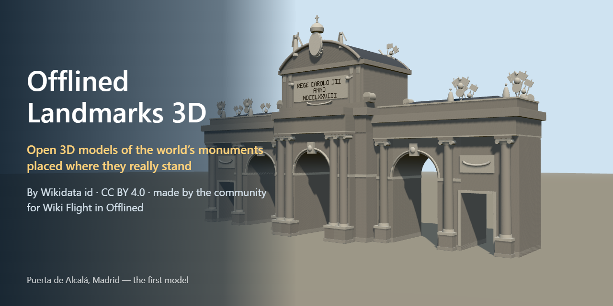

# Offlined Landmarks 3D

*[Leer en español](README.es.md)*

**Open 3D models of monuments and landmark buildings — each one linked to its Wikipedia article by its
Wikidata id, at real size, placed and turned exactly where it stands.**

A project of [Offlined](https://www.offlined.org), the offline library with Wikipedia, maps and the relief of
the whole planet. In Offlined's *Wiki Flight* you fly over your own downloaded maps, where every building is
drawn by code from OpenStreetMap — a good city, but a city of boxes. With these models, **the landmarks look
like themselves**: the generic building is taken away and the real one stands in its place. Fly through the
ring of a monument that has a model, and next to its Wikipedia article you get the model in a viewer, **with
the name of its author and the number of models they have contributed**.

**[▶ See the models in 3D](https://aruvaro-chulvi.github.io/OfflinedLandmarks3D/)** — turn them around, check
their real size against a person, open their Wikipedia article, download the `.glb`.

## What is here

| | |
|---|---|
| [`models/`](models/) | The 3D models, one folder per Wikidata id: `model.glb`, `meta.json` (author, licence, sources, position, orientation, rights) and `preview.jpg`. 80 landmarks so far: 36 in **Madrid**, from the [Puerta de Alcalá](models/Q1140634/), the [Puerta de Hierro](models/Q962107/), the [Cuartel del Conde Duque](models/Q5191859/), the [Palacio Real de El Pardo](models/Q1368571/) and the [Palacio Real](models/Q171517/) to the [Cuatro Torres](models/Q519568/) with [Caleido](models/Q22970105/), [Torrespaña](models/Q989733/), the [Atocha station](models/Q23093/), the [Teatro Real](models/Q211250/), the [Metropolitano stadium](models/Q1369687/) and [Terminal 4 of Barajas](models/Q166276/); in the Community of Madrid the [Monastery of El Escorial](models/Q28471/) with its gardens, the [Casita del Infante](models/Q953919/) with its terraced gardens, the [Casita del Príncipe](models/Q3848635/) with its gardens, the ruined [Presa de El Gasco](models/Q1297922/), the [Royal Palace of Aranjuez](models/Q530129/) with its gardens, the [Casa del Labrador](models/Q5755509/), the [castle of Manzanares el Real](models/Q1013093/) and the [Monastery of El Paular](models/Q1752772/); in **Toledo** the [Cathedral](models/Q1123180/), the [Alcázar](models/Q1326589/), [San Juan de los Reyes](models/Q1289106/), the synagogues of [El Tránsito](models/Q1811506/) and [Santa María la Blanca](models/Q1568115/), the mosque of [Cristo de la Luz](models/Q1324080/) and the bridges of [Alcántara](models/Q581532/) and [San Martín](models/Q1518670/); in the rest of Spain the [walls of Ávila](models/Q3050235/), the [Alhambra](models/Q47476/) and the [Sagrada Família](models/Q48435/); and the great landmarks of the world: the [Colosseum](models/Q10285/), [St Peter's](models/Q12512/) with its square, the [Piazza dei Miracoli of Pisa](models/Q39054/), the [Eiffel Tower](models/Q243/), [Notre-Dame](models/Q2981/), the [Arc de Triomphe](models/Q64436/), [Westminster and Big Ben](models/Q62408/), [Tower Bridge](models/Q83125/), [Stonehenge](models/Q39671/), the [Brandenburg Gate](models/Q82425/), [Neuschwanstein](models/Q4152/), the [Acropolis of Athens](models/Q10288/), [Hagia Sophia](models/Q12506/), [St Basil's and the Spasskaya Tower](models/Q129846/), the [pyramids of Giza](models/Q37200/), the [Taj Mahal](models/Q9141/) with its garden, the [Forbidden City](models/Q80290/), [Angkor Wat](models/Q43473/), the [Burj Khalifa](models/Q12495/), the [Sydney Opera House](models/Q45178/), the [Statue of Liberty](models/Q9202/), the [Empire State Building](models/Q9188/), the [Golden Gate Bridge](models/Q44440/), [Machu Picchu](models/Q676203/) and [Christ the Redeemer](models/Q79961/). |
| [`model_sources/`](model_sources/) | Models built by code (Python + [`tools/meshkit.py`](tools/meshkit.py)): run the script, get the `.glb`. |
| [`docs/MODEL_SPEC.md`](docs/MODEL_SPEC.md) | The rules every model follows: glTF `.glb`, metres, axes, origin, size limits, `meta.json`. |
| [`site/`](site/) | The web page published on GitHub Pages. |
| [`tools/`](tools/) | The model checker that runs on every pull request, the release builder, a renderer to look at a model without a browser, and helpers for Wikidata and OpenStreetMap (outline, heights, centre, orientation). |

## How it works in Offlined

1. Offlined downloads the latest [release](https://github.com/Aruvaro-Chulvi/OfflinedLandmarks3D/releases/latest):
   its `manifest.json` and the models, each one checked by size and SHA-256. Only the landmarks you choose (the
   whole world, one country or one author), gzip-compressed: about a fifth of the size of the `.glb` files.
2. In Wiki Flight, where a model stands, the buildings, trees and street lamps that the map would have
   drawn inside its **footprint** are not drawn, and the model is set on the ground, turned to its real
   heading.
3. **It runs on modest computers.** Every release carries a far-away version of each model (about 1/8 of its
   triangles, made automatically). The full model is only drawn close by, and only a few at a time (2, 4 or 8
   depending on the quality setting); beyond 7 km, nothing. A model is limited to 150,000 triangles and 8 MB.
   A plane crashes only against what is really there: each release also carries a **collision volume** for every
   model (a few hundred boxes made automatically from it), so arches, the space under a bridge deck and the air
   between towers can be flown through; gaps narrower than 6 m, where no plane fits, are closed.
4. When you fly through the ring of a monument that has a model, its card shows the model, its author and how
   many models that author has contributed. The models are found by Wikidata id, so this works in all ten
   languages of Offlined.

## Contributing

**Everyone can add a landmark** — with Blender or any program that exports glTF, or by code. Your name goes on
the model's card in Offlined, for everyone who flies over it, together with the number of models you have
contributed. Not sure which one? The **[wanted list](WANTED.md)** has landmarks ready to start, with their
Wikidata id, OpenStreetMap outline and what is known of their size. You can also help without modelling: ask for
a landmark, or point out a model in the wrong place.

Every contribution goes through the automatic check, a review by the maintainer, and only then into a release —
Offlined downloads nothing that has not been published there. See [CONTRIBUTING.md](CONTRIBUTING.md).

### Contributors

| | Models |
|---|---:|
| [Álvaro C. Chulvi](https://github.com/Aruvaro-Chulvi) | 80 |

## Licences

- **Models:** [CC BY 4.0](https://creativecommons.org/licenses/by/4.0/) (or [CC0 1.0](https://creativecommons.org/publicdomain/zero/1.0/) if the author prefers) — free for any use, also commercial, crediting the authors.
- **`meta.json`:** [CC0 1.0](https://creativecommons.org/publicdomain/zero/1.0/).
- **Code:** [MIT](LICENSE).

A building is itself a copyrighted work while its architect's rights last, so each model says whether the
building is in the public domain or a protected modern work; both are accepted, and any rights holder can ask
for a model to be taken out. Details, sources and how to credit: [NOTICE.md](NOTICE.md).

Data: [Wikidata](https://www.wikidata.org) (CC0) · [OpenStreetMap](https://www.openstreetmap.org/copyright) (© OpenStreetMap contributors, ODbL).
